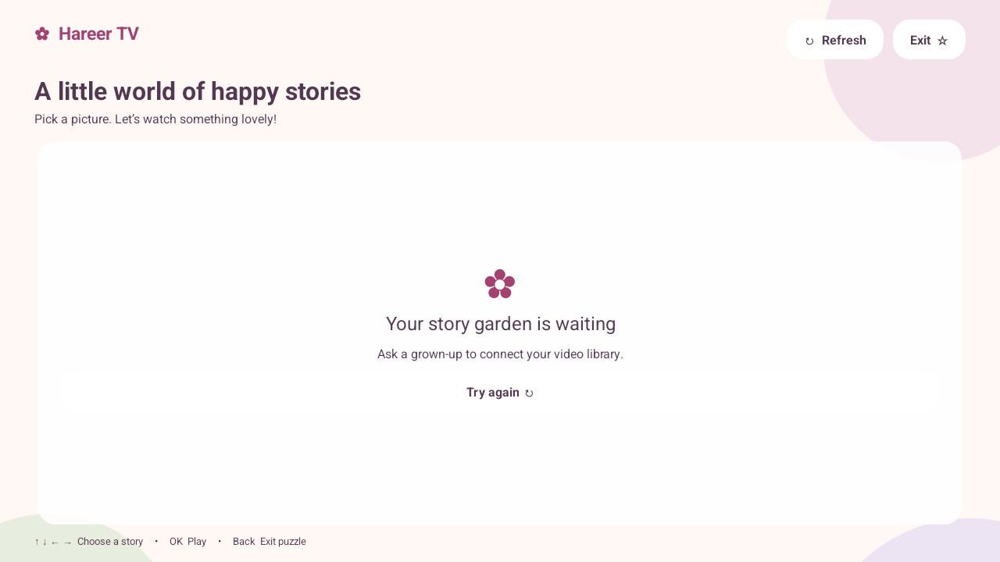
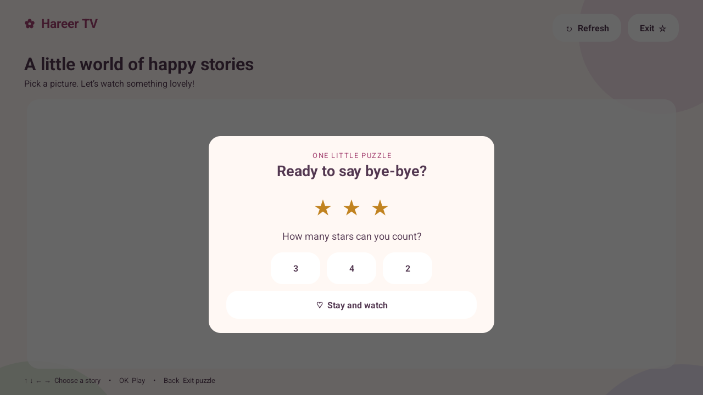

# Hareer TV

A simple Android TV app for a family's hand-picked videos. Children choose a picture, watch inside the app, and solve a little star-counting puzzle when they want to leave.

Built with a soft pink, lavender, and mint design, large picture cards, and TV-remote navigation.

[](https://github.com/MohammaedAlani/hareer-tv/actions/workflows/android.yml)
[](LICENSE)

## What it does

- Shows a title and image for every video supplied by your backend.
- Plays stored video files inside the app, with play/pause and forward seeking.
- Supports directional buttons and OK on a TV remote.
- Asks a simple “how many stars?” puzzle before exiting through the app.
- Supports Android lock-task mode on appropriately configured devices.

This repository contains the **Android app, a landing page, and a small SQLite catalog backend**. You supply the video files and images through S3 or another media host. No videos are bundled. The backend can queue permitted YouTube links, download them one at a time, upload to S3, and publish completed videos to the app. The Android player uses the stored files, not YouTube watch pages.

[Import links & configure S3](docs/IMPORTS.md) · [Admin page](https://tv.nawaa.app/admin)

[Download the signed APK](https://github.com/MohammaedAlani/hareer-tv/releases/latest) · [Deploy to Kubernetes](docs/DEPLOYMENT.md) · [Build releases locally](docs/RELEASING.md)

The official APK reads `https://tv.nawaa.app/videos.json`. The landing page for that domain is in `site/`; it deploys automatically from `main` (see [deployment](docs/DEPLOYMENT.md)).

## Preview




The home screenshot shows the empty state before a backend is connected. Once connected, the app displays your videos as picture cards.

## Quick start

You need Android Studio or the Android command-line SDK, **JDK 17**, Android SDK Platform **35**, and Build Tools **35.0.0**. The app supports Android **8.0 / API 26 or newer** and is intended for Android TV in landscape orientation.

```sh
git clone https://github.com/MohammaedAlani/hareer-tv.git
cd hareer-tv
```

Open the folder in Android Studio and let it configure the SDK. For command-line builds, set `ANDROID_HOME` to your SDK directory, or create an untracked `local.properties` containing `sdk.dir=/absolute/path/to/your/android/sdk`.

Build with your catalog endpoint:

```sh
./gradlew :app:assembleDebug -PcatalogUrl=https://your-server.example/videos.json
```

On Windows, use `gradlew.bat`. Install on a connected TV or emulator with USB/network debugging enabled:

```sh
adb install -r app/build/outputs/apk/debug/app-debug.apk
adb shell am start -n family.blossom.tv/.MainActivity
```

The app appears as **Hareer TV** in the launcher. Its internal package ID remains `family.blossom.tv` for compatibility with the initial development build.

Without `catalogUrl`, the app opens to the empty setup screen. The endpoint is configured at build time; there is no server-settings screen for children to change. The APK itself does not need a local SQLite database.

## Connect your backend

An optional backend is included in `backend/`. It stores video metadata in SQLite, exposes this catalog format, and provides token-protected add/update/delete APIs. See [deployment and API instructions](docs/DEPLOYMENT.md).

Return an HTTP 200 JSON response with `Content-Type: application/json`:

```json
{
  "videos": [
    {
      "title": "My favourite story",
      "imageUrl": "https://your-server.example/media/story.jpg",
      "videoUrl": "https://your-server.example/media/story.mp4"
    }
  ]
}
```

See [examples/videos.json](examples/videos.json). The endpoint can be a static JSON file or an API backed by SQLite or another database.

| Field | Required | Meaning |
| --- | --- | --- |
| `title` | Yes | Display title, 1–200 characters after trimming |
| `imageUrl` | Yes | Absolute image URL; use JPG or PNG |
| `videoUrl` | Yes | Absolute URL to your stored video file |

Return only the videos you want children to access, in the order you want them displayed. Return `{"videos": []}` for an empty library. The current catalog limit is 300 entries; malformed entries reject the response rather than partially loading it.

For video, MP4 with H.264 and AAC is a practical starting point; playback depends on the device's codecs. Your media server should provide correct content types, byte-range requests for seeking, and MP4 fast-start. URLs must work without interactive sign-in; signed media URLs can be returned by the backend.

The catalog reloads at launch, on Refresh, and on returning from a video. There is no offline catalog cache. Removing an entry does **not** interrupt an already playing video or invalidate an old media URL. Enforce authorization and revocation on your media server if you need them.

Debug builds allow HTTP for local development. Release builds require HTTPS. A standard Android emulator reaches the development machine at `10.0.2.2`; a physical TV needs an address it can reach on your network.

## Remote controls and exit

| Button | Action |
| --- | --- |
| Arrow keys | Move between cards and controls |
| OK / Enter | Select a video or control |
| Media play/pause | Toggle playback |
| Back during playback | Return to the video list |
| Back from the list / Exit | Open the star-counting puzzle |
| Back from the puzzle | Stay in the app |

A wrong answer keeps the puzzle open; a correct answer exits. **The puzzle is intentionally easy for a child. It is not a parental PIN.**

An ordinary Android app cannot block Home or all system shortcuts. Preventing Home/Recents from leaving the app requires device provisioning for kiosk mode. See [kiosk setup and limitations](docs/KIOSK.md) before enabling it on any device.

## Build and test

```sh
./gradlew :app:testDebugUnitTest :app:lintDebug :app:assembleDebug
```

GitHub Actions runs Android unit tests/lint, backend tests, and JavaScript syntax checks for pushes and pull requests. **APK builds and signing happen on the maintainer’s machine, never in GitHub Actions.** The server image downloads the exact APK from GitHub Releases and verifies its checksum. Pushes to `main` that change the server files deploy the website and catalog to `tv.nawaa.app` automatically. See [the release workflow](docs/RELEASING.md).

For a signed release build, run `python3 scripts/build-release.py` with JDK 17 configured. The script keeps signing material outside the repository. See [RELEASING.md](docs/RELEASING.md) before publishing. Debug APKs are intended for development.

The current version has five catalog unit tests. Playback, remote navigation, puzzle behavior, and provisioned kiosk mode have been exercised on an Android 35 emulator with a 1280×720 display. Physical TV and vendor-specific remote behavior still need testing. The interface is currently English-only.

## Privacy and content

The app includes no analytics, advertising SDK, or account system. It fetches your catalog, thumbnails, and selected videos from the URLs you provide; those servers can observe requests and IP addresses. Catalog URLs are embedded in the APK, so they must not contain permanent credentials. A fixed catalog URL is not an authentication mechanism.

Host only content you have the right to use and share. The software license does not grant rights to any videos, artwork, or other media you supply.

## Contributing

Bug reports, TV compatibility reports, translations, and improvements are welcome. See [CONTRIBUTING.md](CONTRIBUTING.md) for development and testing guidance and [SECURITY.md](SECURITY.md) for private vulnerability reports.

## License

[MIT](LICENSE) © 2026 Mohammed Alani. You may use, modify, and distribute the app under that license.
